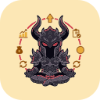

  

<h1 align="center">SkuaLink</h1>

  Watch your Skua bots from your phone and control them. SkuaLink was made to keep an eye on the progress of the bots,
  and to start and stop them, from far away. The author hopes it helps other Skua users with the same need.

  

  Self-contained single file · SHA-256 checksum next to every release · <a href="#install">how to install</a>

  

## What it does

SkuaLink puts your Skua bots on your phone. See what each Skua is doing and its progress, then start or stop its scripts without going back to the PC.

- **From your phone:** state, active quests, live reputation and a log for each Skua you run, and the controls to stop a script or start another one with its options. Navigation is a floating dock; the page is installable and has a light, dark or system theme.
- **Several Skua at once:** one chip per Skua, each with its own state, log and controls.
- **Hands off the game:** with the optional [Skua plugin](#skua-plugin), and only when you ask from the phone, it can start and stop Skua scripts and read or write the options file of a script in Skua's scripts list. It never sends anything to the game.
- **Game data, optional:** SkuaLink can also read the data the game sends to your own computer to show your characters' numbers, reputation and Hard Farms. This needs [Npcap](https://npcap.com/) and is independent of Skua: see [Game data](#game-data-optional).
- **Local:** everything stays on your computer. No telemetry. **Forget my data** (in **Settings**) removes it. Nothing leaves the PC except the Wiki request you start and, if you turn them on, [Phone access](#watch-and-control-from-your-phone) and the [Skua plugin](#skua-plugin).

## Install

You need 64-bit Windows and [Skua](https://github.com/auqw/Skua) for the bot controls. [Npcap](https://npcap.com/) is needed only for the optional [game data](#game-data-optional); you install it yourself from its own site (its license does not allow other programs to bundle it; it is free for personal use on up to five computers).

1. Download `SkuaLink-Setup-vX.Y.Z.exe` from the [latest release](https://github.com/agvmdsa/SkuaLink/releases/latest) and run it. It tells you whether Npcap is installed and opens the official download page if it is not.
2. Start SkuaLink from the Start menu. Windows asks for administrator rights each time.
3. The builds are not code-signed yet, so SmartScreen may warn you: choose **More info**, then **Run anyway**, if you trust the file. You can compare the download with `SHA256SUMS.txt` (`Get-FileHash .\SkuaLink-Setup-vX.Y.Z.exe -Algorithm SHA256` in PowerShell).
4. For the bot controls, set up the [Skua plugin](#skua-plugin) and [phone access](#watch-and-control-from-your-phone).

No installer? Download the `.zip` instead, extract it anywhere and run `SkuaLink.exe`. Your data, logs and crash reports live in `%LOCALAPPDATA%\AqwCompanion`; delete that folder to remove everything the app stored.

## Watch and control from your phone

Off by default. **Settings, "Watch my characters from my phone"** serves a small page on a phone you pair, updating live. With the [Skua plugin](#skua-plugin) it shows each Skua and can start and stop scripts; with the optional [game data](#game-data-optional) it also shows your characters' numbers, reputation and Hard Farms. It works as an installed web app, with a light, dark or system theme.

**You need:** [Tailscale](https://tailscale.com/) on this PC and on your phone (same account), **MagicDNS** and **HTTPS certificates** turned on once in the Tailscale admin console (the app tells you which step is missing), and SkuaLink running on the PC. The phone reaches the page only through your own tailnet; nothing is opened to the internet.

**Steps:** turn on the switch, press **Pair a phone...**, scan the QR code with the phone camera, then add the page to the home screen (on an iPhone: Share, then Add to Home Screen). A pairing link works once and for 5 minutes. Each paired phone can be revoked in the same window.

- **Installed to the Home Screen first?** An iPhone Home Screen app keeps its own storage, so pairing in Safari does not pair it. Open the installed app, use the **Pairing link** field on its "Not paired" card and paste the link there.
- **PC off?** The page opens from its saved copy within a few seconds and says it cannot reach SkuaLink, with how old the last data is.
- Anyone on your tailnet can open the page, but only a paired phone sees any data.
- Push notifications (a notice while the page is closed) do not exist yet.

## Skua plugin

An optional, separate download for people who play with [Skua](https://github.com/auqw/Skua) (a third-party game client). `SkuaLink.SkuaBridge.dll` runs inside Skua and shows its state in the **Skua** tab of the phone page: what the character is doing (server, map, script running), the **active quests** (the ones ready to turn in marked) and a short **log** with filters (buys, sells, drops, map changes, script start and stop, deaths).

The tab shows each Skua's **reputation** live and groups repeated drops in the log ("Drop: Blood Orb x13"). It can also **start and stop scripts**: pick one from the scripts in Skua's scripts folder (bot scripts only, with the title and description from the script's header; search by name, folder, description or tag), set its options if it has any, and press Start. Several Skua can run at once: the tab shows one chip per Skua (a list above 5) and every action goes to the Skua you picked.

The plugin does exactly five things for SkuaLink: list the scripts in Skua's scripts folder, read and write the options file of one of them, start a chosen script, and stop the running one. It never accepts a file path or code from the phone, and it sends nothing to the game. Skua may open a script's options window on the PC when it starts; the plugin closes that window itself, and if it cannot, the phone says "Waiting for you on the PC".

1. Download `SkuaLink.SkuaBridge.dll` from the [latest release](https://github.com/agvmdsa/SkuaLink/releases/latest) (check it against `SHA256SUMS.txt`).
2. Copy it into `%AppData%\Skua\plugins` (the **Skua** block in **Settings** opens that folder) and reopen Skua. With SkuaLink running, that block reads "Skua connected".
3. To remove it, close Skua and delete the file.

The plugin and SkuaLink must come from the same release: with an older plugin the tab shows the state but cannot start or stop anything. Tested with Skua 1.4.5.0. Up to 8 Skua at once; log lines appear while a script is running; Skua started as administrator is not supported. Skua publishes no license: the plugin only references its interfaces and copies none of its code.

## Game data (optional)

SkuaLink can listen to the data the game already sends to your own computer and show it in one screen while you play: your character, your factions (closest to the next rank first) and the Hard Farms list, with what you own marked from your captured inventory. It is read-only and local, needs [Npcap](https://npcap.com/), and none of the Skua features depend on it.

### Using it

Open the app, then open the game launcher and log in. The capture starts by itself and has to be listening **before** the login, because the game sends your data only once, during it. Your character appears on its own.

- **Character chip** (top bar): switch between characters when several are logged in.
- **Hard Farms:** press **Update from the Wiki** in its card; the list is imported on your click and never bundled (CC BY-SA 3.0).
- **Settings** (the gear): start with Windows, the privacy text, **Forget my data**, credits.
- **Tray icon:** closing the window hides it and the capture keeps listening. **Exit** in the tray menu really closes the app.
- **Nothing shows up?** Open the debug mode (Settings, or Ctrl+Shift+D) for the capture controls and the diagnostics export.

If you open the app while already logged in to the game, it shows the data saved from your last session and says so; switching server or logging in again sends the login again.

### What it reads, and what it does not

From the server's messages only: character name and level, experience, gold, AC, class points, days played, membership, slots, boosts, faction reputation, and each owned item. It never reads or keeps your e-mail, IP address, password, user or character ids, or anything about other players. It listens only to the game's TCP ports 5588 to 5594 and drops the client-to-server side, where the login travels, before looking at it.

After the login it follows a few of your own events (gold and experience gained, items picked up or sold, class points). **Not tracked yet:** buying, quest rewards, reputation gains, level-ups, trades and bank moves, so the numbers can drift from the game until you log in again. The bank, quests and achievements are not read.

## For developers

- [Local feed](docs/local-feed.md): a read-only feed for other programs on the same PC.
- [Build from source and releases](docs/building.md).
